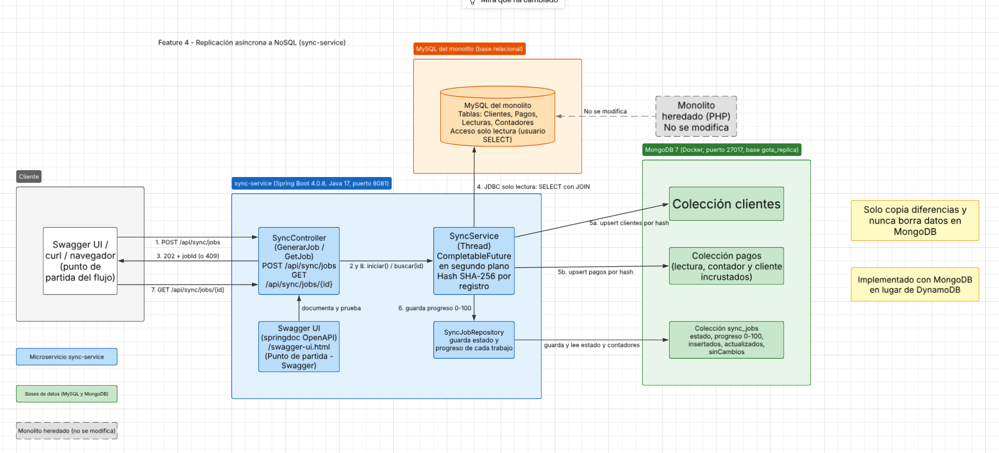

Nombre: Gabriel Enrique Villanueva Hernández  
Carnet: 0905-23-21427  
Repositorio: https://github.com/NasaGV/sync-service  
Modulo asignado: Replicación asíncrona a NoSQL  

# sync-service

Microservicio de replicación asíncrona de la Oficina del Agua. Copia clientes y pagos del sistema heredado (MySQL) hacia MongoDB, en segundo plano, copiando solo lo que cambió y sin borrar nunca nada en el destino.

La documentación se redactó con ayuda de Claude (Anthropic) y se verificó contra el código del repositorio.

## Arquitectura de la feature



Componentes:

| Componente | Función |
|---|---|
| `SyncController` | Expone `POST /api/sync/jobs` y `GET /api/sync/jobs/{id}` |
| `SyncService` | Ejecuta la sincronización en segundo plano (`CompletableFuture`) y calcula un hash SHA-256 por registro |
| `SyncJobRepository` | Guarda el estado y el progreso de cada trabajo |
| Swagger UI (springdoc) | Documentación OpenAPI en `/swagger-ui.html` |
| MySQL del monolito | Origen de los datos, acceso solo de lectura |
| MongoDB 7 (Docker) | Destino: colecciones `clientes`, `pagos` y `sync_jobs` |

## 1. Funcionalidad y objetivo

La Oficina del Agua opera con un sistema heredado en MySQL que no puede modificarse. Este servicio mantiene una copia de sus datos en MongoDB, útil para consultas y reportes que no deben cargar al sistema original.

- `POST /api/sync/jobs` inicia la sincronización y responde de inmediato `202 Accepted` con un `jobId`.
- `GET /api/sync/jobs/{id}` devuelve el estado (`EN_PROCESO`, `COMPLETADO` o `FALLIDO`), el progreso de 0 a 100 y los contadores `insertados`, `actualizados` y `sinCambios`.
- Si ya hay una sincronización en proceso, un nuevo `POST` responde `409 Conflict` con el `jobId` del trabajo en curso.

Qué se copia:

- `clientes`: la tabla Clientes tal cual.
- `pagos`: cada pago con su lectura, contador y cliente incrustados, porque en Mongo no hay joins. Se obtienen con `Pagos → Lecturas → Contadores → Clientes`.

## 2. Integración y responsabilidades

- **El monolito no se modifica.** El servicio lee con un usuario de MySQL que solo tiene permiso `SELECT`, de modo que un error del servicio no puede alterar el sistema original.
- **Escribe únicamente en MongoDB**, que es también donde guarda el historial de trabajos (`sync_jobs`).
- **No tiene interfaz gráfica**: se opera mediante la API REST documentada en Swagger.
- **No se comunica con otros servicios de la solución**; su frontera es MySQL (lectura) y MongoDB (escritura).

## 3. Decisiones técnicas

**Hash SHA-256 por registro, en lugar de `updated_at`.** Detectar cambios con una columna de fecha exigía modificar las tablas del monolito, y eso está prohibido. Cada documento guarda un hash de su contenido y se compara en cada corrida:

| Situación | Acción |
|---|---|
| No existe en Mongo | Insertar |
| Existe y el hash cambió | Actualizar |
| Existe y el hash es igual | Omitir |
| Ya no existe en MySQL | No hacer nada (nunca se borra) |

El `_id` del documento es el id de MySQL, por lo que repetir la sincronización es seguro y no duplica datos.

**Otras decisiones:**

- **MongoDB en lugar de DynamoDB:** el requisito admite cualquiera de los dos, y Mongo corre local con Docker sin cuenta en la nube.
- **JDBC en lugar de JPA:** el servicio solo lee filas, así que no necesita entidades ni mapear las columnas generadas de `Lecturas`.
- **`202` con consulta posterior:** el trabajo puede tardar, y bloquear la petición HTTP no escalaría.

## 4. Cómo ejecutar y probar

### Requisitos previos

- Java 17 o superior y Docker.
- La base `gota_db` del monolito en MySQL (`localhost:3306`) con las tablas Clientes, Pagos, Lecturas y Contadores.
- Un usuario de solo lectura (usa una clave propia):

```sql
CREATE USER 'sync_ro'@'localhost' IDENTIFIED BY '<tu_clave>';
GRANT SELECT ON gota_db.* TO 'sync_ro'@'localhost';
FLUSH PRIVILEGES;
```

### Iniciar

```
docker compose up -d
```

Con la clave en una variable de entorno (PowerShell):

```
$env:MYSQL_PASSWORD="<tu_clave>"; $env:SYNC_DEMORA_MS=1000; ./mvnw spring-boot:run
```

En Linux o Mac:

```
MYSQL_PASSWORD="<tu_clave>" SYNC_DEMORA_MS=1000 ./mvnw spring-boot:run
```

`SYNC_DEMORA_MS=1000` agrega una pausa de un segundo por registro, solo para ver el progreso avanzar. Sin esa variable, el trabajo termina en milisegundos.

### Variables de configuración

| Variable | Por defecto |
|---|---|
| `MYSQL_URL` | `jdbc:mysql://localhost:3306/gota_db` |
| `MYSQL_USER` | `sync_ro` |
| `MYSQL_PASSWORD` | sin valor, es obligatoria |
| `MONGO_URI` | `mongodb://localhost:27017/gota_replica` |
| `SERVER_PORT` | `8081` |
| `SYNC_DEMORA_MS` | `0` |

### Flujo de prueba

1. Abrir **http://localhost:8081/swagger-ui.html**.
2. Ejecutar `POST /api/sync/jobs`: responde `202` con un `jobId`.
3. Ejecutar `GET /api/sync/jobs/{id}` varias veces: el `progreso` sube hasta 100 y el estado pasa a `COMPLETADO`.
4. Repetir el `POST` mientras hay uno en curso: responde `409`.
5. **Segunda corrida sin cambios:** `insertados: 0` y `sinCambios` igual al total.
6. **Detección de cambios:** modificar un dato en MySQL (por ejemplo `UPDATE Clientes SET telefono = '55550000' WHERE id = 1;`), sincronizar de nuevo y verificar `actualizados: 1`. Para ver el cambio en Mongo:

```
docker exec sync-mongo mongosh gota_replica --eval "db.clientes.find({_id: 1}).forEach(printjson)"
```

7. **Sin borrado:** eliminar un pago en MySQL, sincronizar y comprobar que Mongo sigue teniendo el documento:

```
docker exec sync-mongo mongosh gota_replica --eval "db.pagos.countDocuments()"
```

### Resultado esperado

Con una base de, por ejemplo, 3 clientes y 5 pagos, la primera corrida con Mongo vacío devuelve:

```json
{
  "estado": "COMPLETADO",
  "progreso": 100,
  "total": 8,
  "insertados": 8,
  "actualizados": 0,
  "sinCambios": 0,
  "error": null
}
```

## Limitaciones conocidas

- Cada corrida lee todas las filas de MySQL; lo incremental es la escritura, no la lectura. Con volúmenes grandes habría que leer por lotes.
- El bloqueo contra corridas simultáneas funciona con una sola instancia del servicio.
- Un borrado en el origen no se refleja en el destino, a propósito.
- No hay pruebas automáticas: la verificación se hizo manualmente con el flujo de arriba.